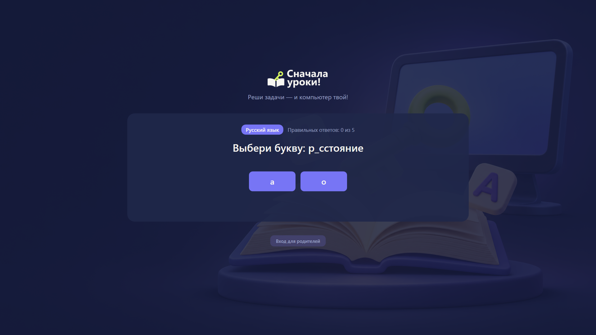
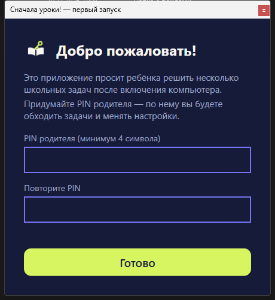

# Сначала уроки!

[](https://github.com/AOlifer/lessons-first/actions/workflows/ci.yml)
[](https://github.com/AOlifer/lessons-first/actions/workflows/release.yml)
[](LICENSE)
[](https://github.com/AOlifer/lessons-first/releases)

<p align="center">
  
</p>

**«Сначала уроки!»** — родительский замок для Windows. После включения компьютера
или пробуждения из сна на главном экране появляются короткие школьные задачи по
математике и русскому языку. Решил — пользуешься компьютером. Не решил — решаешь
дальше. Родитель может обойти задачи по секретному PIN-коду.

## Возможности

| | |
|---|---|
| 🔒 **Полноэкранный замок** | Закрывает все мониторы; задачи — в центре главного. Не сворачивается, Win / Alt+Tab / Alt+F4 / Ctrl+Shift+Esc блокируются |
| 🧮 **Математика и русский** | Задачи трёх уровней: 1–2, 3–4 и 5–6 класс. Примеры, проценты, дроби, орфограммы, формы слов |
| ⚙️ **Гибкие настройки** | Класс, количество задач, автозапуск, блокировка при старте / после пробуждения — по PIN родителя |
| 🎉 **Экран успеха** | После последней задачи — поздравление со статистикой: верные ответы, ошибки, время |
| 🔄 **Автообновление** | Приложение само проверяет GitHub Releases, скачивает новый инсталлятор и обновляется (один клик UAC) |
| 📦 **Инсталлятор** | Setup.exe в Program Files для всех пользователей + портативный zip |
| 👁 **Слежение (watchdog)** | Задача планировщика возвращает приложение, если его закрыли, и стартует его при входе в систему |
| 🌙 **Пробуждение и Win+L** | Замок возвращается после сна и разблокировки сеанса |

## Скриншоты

| Замок с задачей | Первый запуск |
|:---:|:---:|
|  |  |

## Установка

1. Скачайте `LessonsFirst-Setup.exe` из последнего
   [релиза](https://github.com/AOlifer/lessons-first/releases/latest) и запустите —
   потребуется согласие UAC: приложение ставится в `Program Files` для всех пользователей.
2. Придумайте PIN родителя — по нему вы будете обходить задачи и менять настройки.

Инсталлятор по умолчанию регистрирует в планировщике две задачи:
`LessonsFirstLogon` — приложение стартует **при входе любого пользователя**, и
`LessonsFirstWatch` — **проверка каждые 5 минут**: если приложение закрыли
(например, через Диспетчер задач), оно автоматически вернётся.
Повторный запуск приложения не «молчит»: живой экземпляр сразу показывает замок.
Само приложение работает от обычного пользователя, без прав администратора.

Портативный вариант: распакуйте `LessonsFirst-Portable.zip` в любую папку и запустите
`LessonsFirst.exe` (автозапуск — через HKCU Run на текущего пользователя).

## Как это работает

- При запуске Windows приложение стартует автоматически и показывает полноэкранный замок.
- Задачи всегда в центре **главного** монитора; дополнительные мониторы закрываются
  тёмной заглушкой — на них ничего нельзя нажать.
- По умолчанию нужно дать **5 правильных ответов**; ошибки не засчитываются —
  вместо зачёта ребёнок получает новую задачу.
- После разблокировки приложение живёт в трее: «Заблокировать сейчас», «Настройки…»,
  «Поддержать проект», «Сообщить о проблеме», «Выход».

## Настройки (вход по PIN, из трея)

- **Класс** — сложность задач: 1–2, 3–4 или 5–6 класс.
- **Количество правильных ответов** для разблокировки: 3 / 5 / 10 / 15.
- **Автозапуск вместе с Windows**.
- **Блокировать при запуске Windows** и **после пробуждения / разблокировки (Win+L)**.
- **Проверить обновления** — ручная проверка; автоматически приложение проверяет раз в сутки.
  Обновление скачивает новый `LessonsFirst-Setup.exe` и запускает его — достаточно
  подтвердить UAC, инсталлятор обновит файлы в Program Files сам.

## 💚 Поддержать проект

«Сначала уроки!» — бесплатное приложение с открытым кодом. Если оно экономит вам
нервы по утрам — угостите разработчика кофе:

<p>
  <a href="https://pay.cloudtips.ru/p/020a7c72"></a>
</p>

## 🐛 Связь с разработчиком

Нашли баг или есть идея? Заведите issue:
[github.com/AOlifer/lessons-first/issues](https://github.com/AOlifer/lessons-first/issues)

## Брендинг

Графика приложения живёт в каталоге [`lessons-first-brand/`](lessons-first-brand/) —
концепция «раскрытая книга и ключ», палитра Midnight `#151B38` / Periwinkle `#7775F5` /
Paper `#F7F6F2` / Lime `#D7F561`. Описание набора — `lessons-first-brand/README.txt`.

## Дорожная карта

- [ ] Кроссплатформенная версия (macOS, Linux)
- [ ] Облачное хранилище задач: база локальная, новые наборы скачиваются из сети
- [ ] Статистика занятий для родителя
- [ ] Расширение по расписанию («занятия по часам»)

## Честные ограничения

Это сдерживающий инструмент для ребёнка, а не защита от специалиста: замок можно
снять через Диспетчер задач (если успеть до его блокировки), безопасный режим
или другой аккаунт Windows.

## Разработка

- C#, WPF, .NET 9. Ветки: `develop` — разработка, `master` — релизы.
  Релиз публикуется только по явному тегу `v*`, версия берётся из
  `src/LessonsFirst.App/LessonsFirst.App.csproj` (сверяется с тегом).
- Внешние ссылки (репозиторий, донат) — переменные проекта в csproj: `RepoSlug`, `DonateUrl`.
- Сборка и тесты: `dotnet build LessonsFirst.sln` и `dotnet test LessonsFirst.sln`.
- Локальная сборка приложения и инсталлятора:

  ```
  dotnet publish src/LessonsFirst.App/LessonsFirst.App.csproj -c Release -r win-x64 --self-contained -o publish
  ISCC /DVersion=0.1.0 installer/lessons-first.iss
  ```

## Лицензия

Код распространяется по лицензии [MIT](LICENSE).
